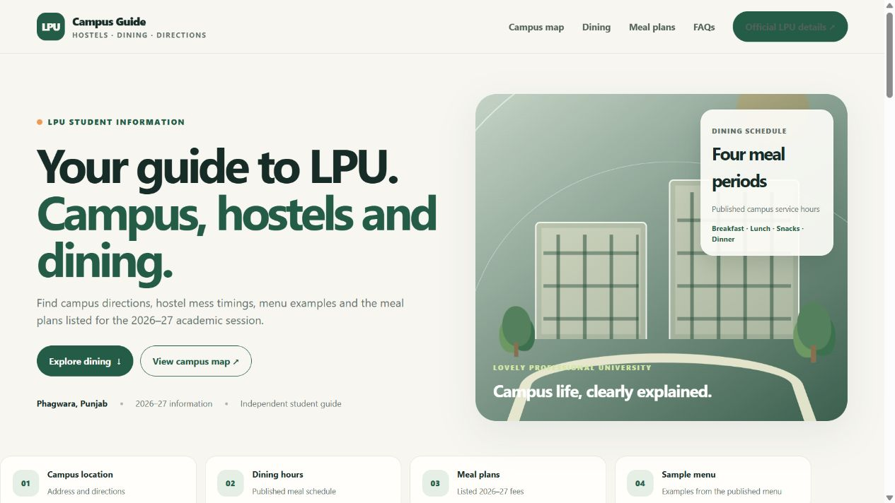

# LPU Campus Guide

A responsive, mobile friendly guide for students and visitors at Lovely Professional University. It brings campus directions, hostel dining information, meal timings, a sample menu and helpful official links together in one place.

**Live website:** [LPU Campus Guide](https://lpu-campus-guide.khanaryan1889.chatgpt.site/)



## What it includes

- Campus location and directions through an embedded Google Map
- Hostel dining overview, meal timings and a sample menu
- Listed mess fee information with a reminder to confirm current details
- Quick links to relevant LPU resources
- Responsive layout for phones, tablets and desktop screens

## Built with

- HTML5
- CSS3
- Vanilla JavaScript
- Google Maps embed

The site is a static page and does not need a framework, build step or server-side setup.

## Run locally

Download or clone this repository, then open `index.html` in a browser. To preview it through a local web server, run:

```bash
python -m http.server 8000
```

Then visit `http://localhost:8000`.

## Project structure

```text
.
├── index.html
├── README.md
└── preview.png
```

## Information note

This is an independent student project and is not an official LPU website. Dining schedules, fees and campus information can change; please confirm current details with LPU before making decisions.


